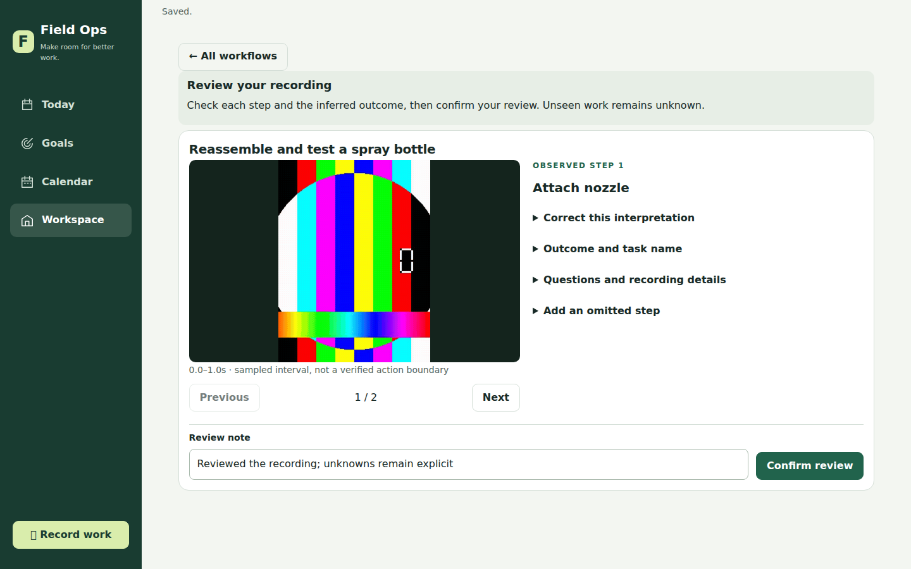
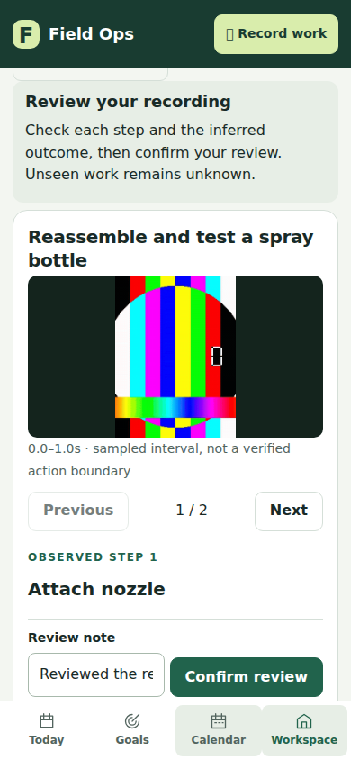

# Focused video review and looping segment previews

Review now occupies its own workspace activity. The workflow directory, follow-up
forms, maps, spatial evidence and improvement trials do not render beneath it.
All workflows returns to a compact directory; supporting tools open one activity
at a time. Contextual location links remain inside recording details.

The review shows one retained clip and one observed step, a looping GIF, Previous /
Next and confirmation. Outcome editing, recording metadata, corrections and
unobserved suggestions are secondary disclosures. Suggestions never receive an
observed step number or GIF. Multiple retained clips have an explicit clip switch.

The journey analysis adapter now requests the existing FFmpeg GIF generation path.
Successful previews return explicit frame indices and interval bounds. Missing
previews fall back to the original recording. Blank observations preserve original
frame indices, preventing later GIFs from being attached to an earlier action.
Each preview is capped at eight seconds, and failed GIF extraction does not discard
successful analysis. These are sampled video intervals, not verified action
boundaries or SAM object masks.

Older recordings: open **Questions and recording details**, then **Reanalyze and
generate segment GIFs**. This explicitly creates a new interpretation and requires
review again; previous interpretations/corrections remain retained.

## Verification

- 326 tests: 314 passed, 12 skipped, zero failures.
- Real FFmpeg test creates portrait video and indexed GIFs; the existing scanner
  integration test verifies GIF extraction with injected model output.
- Review browser smoke uses a generated test-pattern video and real FFmpeg GIFs.
  Checks GIF loading/switching, hidden unrelated tools, corrections, save-only,
  reload/resume, returning to the directory, and opening one supporting activity.
- Desktop default review fits 1440×900 without page scrolling. Responsive checks
  include 390×844 and 320×844 without horizontal page overflow. On phones, details
  may scroll; confirmation stays above the bottom navigation.
- Full journey browser smoke passes through calendar acceptance, partial progress,
  follow-up and replan. No listening server is needed: tests drive real handlers
  and SQLite through Playwright request interception.
- Live model quality was not tested. Screenshots show synthetic test-pattern media
  with injected spray-bottle descriptions, not actual user footage.

Run the app's `scripts/review-ui-smoke.mjs <new-absolute-output-directory>` or
`scripts/journey-ui-smoke.mjs <new-absolute-output-directory>` with Playwright and
FFmpeg installed. `PLAYWRIGHT_CHROMIUM_EXECUTABLE` can select installed Chromium.

