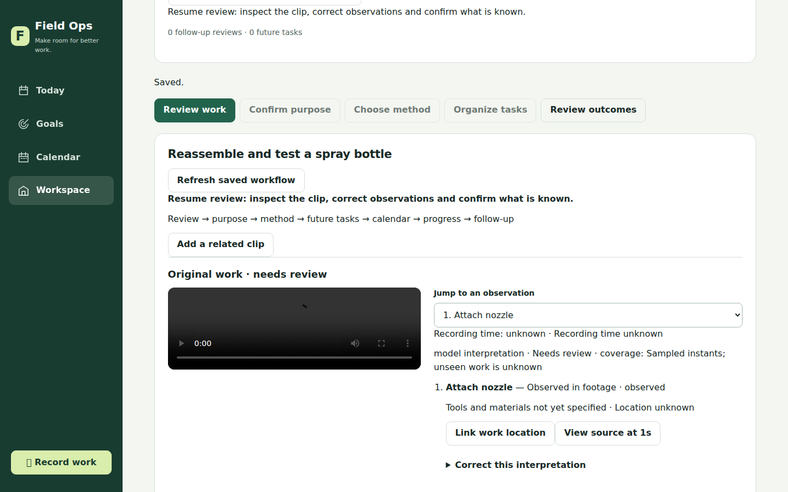
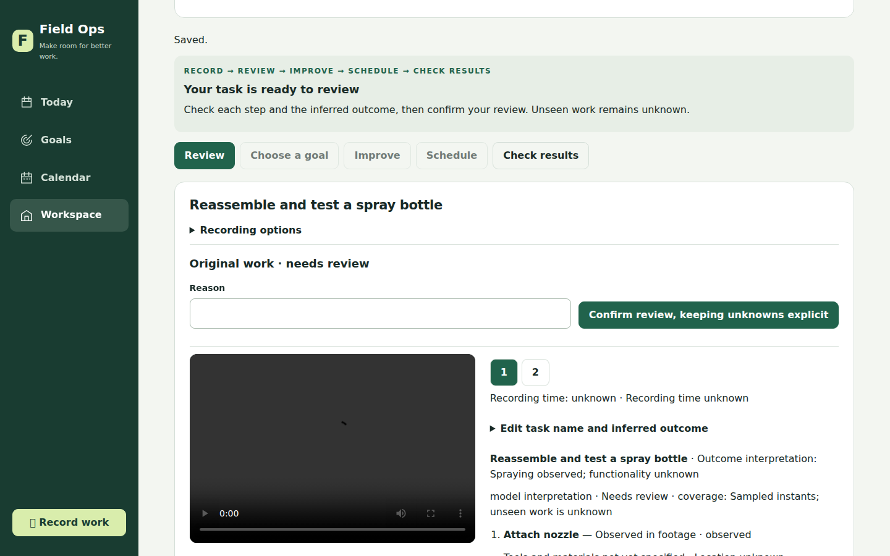
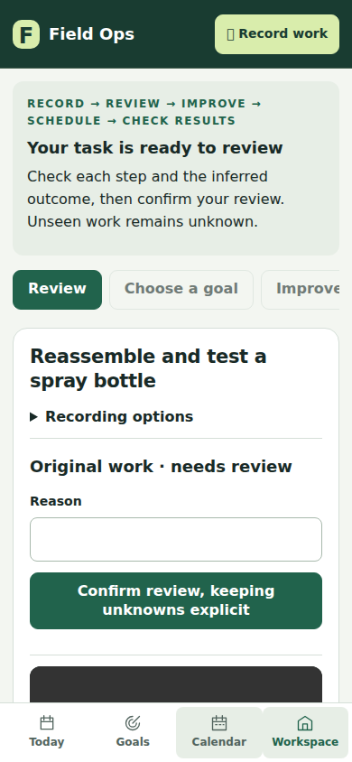

# Guided review: issue 66

The screenshot reported in the issue predates the workflow UI already on main at
90f9f7c. This change builds on that implementation rather than restoring the old
Run screen. The before image here is the current main UI, not the original report.

## Walkthrough

1. Record work → upload a clip. Analysis returns directly to review guidance.
2. Read the outcome as an interpretation. Use numbered steps to inspect evidence
   and uncertainties; correct a step or edit the task name/outcome as needed.
3. Confirm review using the controls above the evidence. Corrections preserve
   older revisions and require fresh confirmation.
4. Save observation only to stop here. This survives reload and creates no goal,
   task, or calendar reservation. Continue to goals and planning resumes the flow.
5. Alternatively confirm a goal, choose supported improvements or current
   practice, explicitly add future work, and review calendar availability/plan.
6. Record progress and follow-up from the task. Existing evidence reconciliation
   and outcome comparison keep observations distinct from verified results.

## Validation

- `npm test`: 322 tests, 310 passed, 12 skipped, zero failures.
- `scripts/journey-ui-smoke.mjs`: real dashboard DOM, HTTP handlers and SQLite;
  capture → correction/reload → goal → method → future task → availability →
  accepted schedule → partial progress → follow-up → replan; keyboard controls
  and no page overflow at 320, 390 and 1440 pixels.
- `scripts/review-ui-smoke.mjs`: spray-bottle scenario, step navigation,
  name/outcome correction, save-only/reload, resume, desktop action above fold,
  and responsive screenshots at those same widths.
- Both browser checks use injected synthetic analysis and non-playable fixture
  bytes. They verify UI/persistence, not model quality or actual video playback.
- Screenshots were visually inspected. Black media panels represent fixture
  bytes; they are not footage from the user's recording.

Run from the app directory with Playwright available; optionally set
`PLAYWRIGHT_CHROMIUM_EXECUTABLE` to an installed Chromium binary. Pass a new
absolute output directory to either smoke script. No listening server is used.

## Screenshots

Before (main):

After:

